# Contre-audit visuel de KIINI SAWA — 25/11/2026

Demande du fondateur : « la cohérence visuelle d'ensemble, l'expérience utilisateur, la beauté de l'application, les
parcours pour qu'ils soient suivis… bref tout ce qui est visuel ». Complète l'audit technique du 24/11
(`audit-global-2026-11-24.md`). **Rien n'a été modifié dans le code pendant cet audit.**

**Comment** : environ 110 pages capturées automatiquement en local, sur téléphone (390 px) et sur ordinateur (1280 px),
avec un compte gratuit créé pour l'occasion (inscription → code → accueil des nouveaux inscrits → première visite), le
compte PRO de test (avec couple) et l'administrateur ; quatre e-mails rendus ; trois vérifications sur
https://kiinisawa.com (page introuvable, mentions légales, inscription). Captures dans `audit-visuel-2026-11-25/`.

**Ce que je n'ai pas vu** : l'appli mobile n'a pas pu être lancée (pas de version web d'Expo, simulateur à construire) :
elle est jugée d'après son code. Pas de rapport de test réel (le compte PRO n'en a aucun, le remplissage automatique a
échoué) : jugé sur la page de test et la synthèse. Pas de vrai téléphone.

---

## 1. Verdict d'ensemble

**6/10 — une belle base, une finition encore « prototype » par endroits.**

La direction artistique est juste et rare dans ce genre d'application : vert du livre, or, Playfair pour les titres,
beaucoup d'air, des versets mis en scène. La **vitrine**, la **page de la personne invitée** (feedback), l'**Académie**,
l'**administration** et les **e-mails** sont du niveau « produit fini ». Ce qui tire la note vers le bas, ce n'est pas le
goût, c'est **l'accumulation** : chaque fonction ajoutée vite a apporté son propre en-tête, sa largeur, ses boutons,
parfois ses couleurs. Pris un par un, les écrans sont corrects ; enchaînés, on sent plusieurs mains. Deux défauts sont
visibles par tous et à corriger avant toute communication (code affiché sur 4 plans, champ date brut à l'inscription).

| Axe | Note | En une phrase |
|---|---|---|
| Cohérence d'ensemble | 5/10 | Trois « visages » (vert sombre en verre, application claire, pages légales en Georgia), sept façons de faire un en-tête, largeurs de page au hasard. |
| Hiérarchie et lisibilité | 6/10 | Titres et textes très lisibles ; mais pages longues sans repère et doublons (« Ma prochaine étape » et « Vos premiers pas » disent la même chose). |
| Une seule action principale | 5/10 | Respecté sur Académie, Redevabilité, Parcours ; pas sur Bilan (2 boutons pleins + 3), Journal, Plan de Vie. |
| États vides, chargements, erreurs | 6/10 | Bons messages vides (Partenaires, Échéances) ; Revue du mois affiche « 0, —, —, 0/0 » ; la page introuvable en ligne est soignée. |
| Finition sur téléphone | 5,5/10 | Onglets coupés ou sur deux lignes, encadré « Comprendre cette étape » écrasé sur 12 pages, « 40 % » coupé, tableau d'Intendance qui déborde. |
| Accessibilité | 5/10 | Boutons blancs sur vert sauge et liens sauge sur vert foncé trop pâles (≈ 2,6 à 2,9 pour 1, il faut 4,5) ; beaucoup de textes de 10–11 px dans l'appli mobile. |
| Ton et microcopie | 8/10 | Chaleureux, français soigné, versets bien choisis. Quelques mélanges : « email » / « e-mail », MAJUSCULES sur la connexion, « 360 » collé à tout. |
| Continuité des parcours | 6/10 | Progressions visibles (premiers pas 1/5, Académie 0/2, Parcours de 90 jours) ; mais aucune récompense, et le premier écran après l'inscription est un score rouge de 40/100. |
| Beauté | 6,5/10 | Vitrine 8,5 ; Académie et page invitée 8 ; cœur de l'application 6 ; pages légales et connexion 5. |

Ce qui est déjà au niveau visé, et qui doit servir de modèle au reste : la vitrine, la page de la personne invitée,
l'Académie.

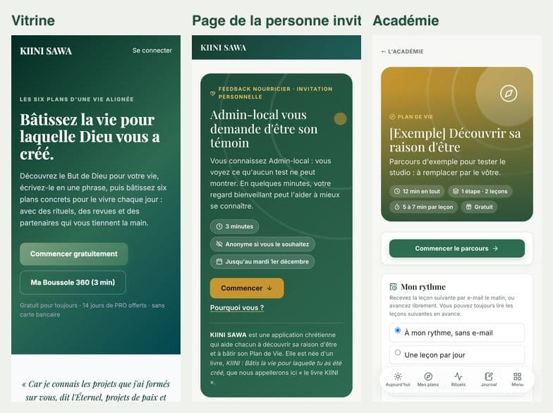

---

## 2. Les 10 problèmes les plus visibles

### 1. Du code informatique s'affiche en haut de 4 plans sur 6

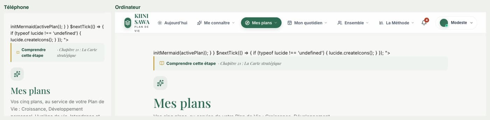

- **Ce qui ne va pas** : sur le Plan de Croissance, de Développement, d'Hygiène de vie et de Transmission, une ligne de
  programme (`initMermaid(activePlan)); } } $nextTick(…`) apparaît tout en haut, et la page ne s'ouvre pas sur le plan
  demandé mais sur la page générale « Mes plans ». Téléphone et ordinateur, **aussi en production** (le défaut date de la
  refonte de `/mes-plans`).
- **Pourquoi c'est important** : c'est la première chose qu'on voit en ouvrant un plan ; ça crie « site cassé ».
- **Correction** : une erreur de guillemets dans `templates/plan_de_vie/plans.html.twig` (ligne ≈ 699, valeur passée au
  JavaScript entre guillemets doubles). Moins d'une heure, avec un test.

### 2. Trois visages et quatre logos

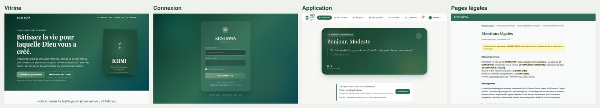

- **Ce qui ne va pas** : la vitrine et l'application sont claires et éditoriales ; la connexion, l'inscription, la
  vérification d'e-mail, l'accueil des nouveaux inscrits et la Boussole sont en « verre » sur dégradé vert sombre ; les
  pages légales et la page introuvable utilisent une autre police (Georgia) et un bandeau vert plein. Le logo change :
  mot seul (vitrine), pictogramme « couches » générique (connexion), pastille « KS » (administration), écusson + « KIINI
  SAWA / PLAN DE / VIE » coupé sur trois lignes dans la barre de l'application.
- **Pourquoi** : la marque se reconnaît à sa constance. Passer de la vitrine claire à une connexion sombre donne
  l'impression de changer de site au moment précis où l'on fait confiance.
- **Correction** : un seul logo (écusson + mot, sur une ligne), une seule police de titre partout, les pages d'entrée
  sur le fond clair de l'application (le vert sombre réservé à un bandeau, comme sur la page invitée). ½ à 1 journée.

### 3. Les pages n'ont pas la même largeur ni le même alignement sur ordinateur

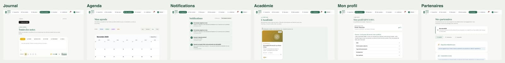

- **Ce qui ne va pas** : dix largeurs différentes d'une page à l'autre (720, 760, 820, 850, 860, 900, 960, 1000, 1080,
  1100 px) : Journal, Notifications, Mon profil KIINI SAWA en colonne étroite ; Agenda, Académie, Plans en pleine
  largeur, avec un contenu calé à gauche qui paraît décentré.
- **Pourquoi** : en passant d'une rubrique à l'autre, le contenu « saute ». C'est le signe le plus net du travail à
  plusieurs mains.
- **Correction** : trois largeurs seulement (lecture 720 px, standard 1040 px, large pour Agenda et Plans), toujours
  centrées, via `.ks-page`. ½ journée.

### 4. Sept façons de faire un en-tête de page

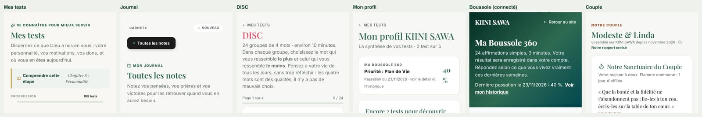

- **Ce qui ne va pas** : surtitre seul (Mes tests), lien retour + surtitre empilés (Bilan du jour : « ← BILAN / PLAN
  D'HYGIÈNE DE VIE »), carte blanche centrée avec pastille (Plan de Vie), icône carrée au-dessus du titre (Mes plans),
  titre **rouge** (DISC), pas de titre du tout en haut (Journal commence par une pilule noire « Toutes les notes »),
  bandeau vert plein sans menu (Boussole, même connecté : on sort de l'application).
- **Pourquoi** : l'en-tête est le repère de chaque écran ; s'il change, l'utilisateur se demande où il est.
- **Correction** : toutes les pages sur le gabarit `_page_header` (retour discret, surtitre, titre vert, une phrase).
  1 journée.

### 5. L'encadré « Comprendre cette étape » est écrasé sur téléphone

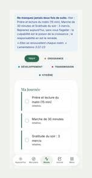

- **Ce qui ne va pas** : présent sur une douzaine de pages (Rituels, Bilan, Revues, Mes tests, Plans…), il garde deux
  colonnes sur 390 px : « Comprendre / cette étape » d'un côté, le titre du chapitre en italique sur trois lignes de
  l'autre.
- **Pourquoi** : c'est le lien entre l'application et le livre, l'idée la plus forte du produit ; il paraît bâclé.
- **Correction** : sur téléphone, une ligne « Chapitre 22 · Habitudes » sous un petit libellé, flèche à droite.
  1 heure, un seul composant.

### 6. Boutons : trop d'actions principales, et des boutons sans style

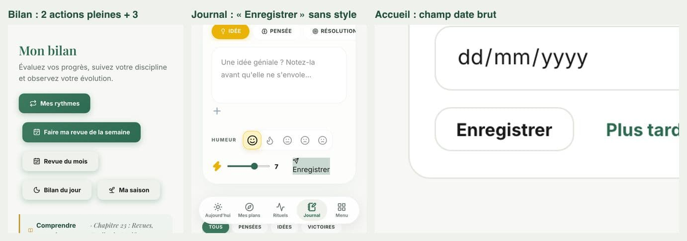

- **Ce qui ne va pas** : Bilan propose 5 boutons, dont 2 pleins de même poids, avec des ombres différentes. Le bouton
  « Enregistrer » du Journal et de la note rapide d'Aujourd'hui n'a aucun style (texte gris surligné). Sur la connexion
  les boutons sont en MAJUSCULES, ailleurs en minuscules. Le champ de date de naissance (Aujourd'hui, Profil,
  Inscription) est le champ brut du navigateur.
- **Pourquoi** : « une seule action principale par écran » est la règle du système visuel ; le bouton qu'on presse le
  plus souvent (Enregistrer une note) ne doit pas avoir l'air d'un bug.
- **Correction** : Bilan → une action « Faire ma revue de la semaine », le reste en liens ou cartes ; « Enregistrer »
  en `ks-btn--primary` ; champs de date stylés. ½ journée.

### 7. Des couleurs hors de la palette du livre

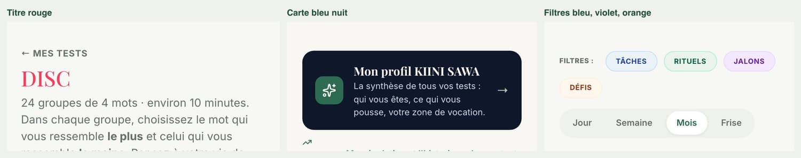

- **Ce qui ne va pas** : titre DISC rouge vif, carte « Mon profil KIINI SAWA » bleu nuit, icônes de tests rose et
  turquoise, filtres de l'Agenda bleu / violet / orange, pilule noire du Journal, points rose et orange des filtres de
  Rituels ; dans l'appli mobile, indigo et rose sur l'écran du couple.
- **Pourquoi** : la palette vert / sauge / or est l'identité ; chaque couleur étrangère la dilue.
- **Correction** : remplacer par les couleurs des plans (`--plan-…`) et `--primary`. ½ journée.

### 8. La première visite décourage au lieu de récompenser

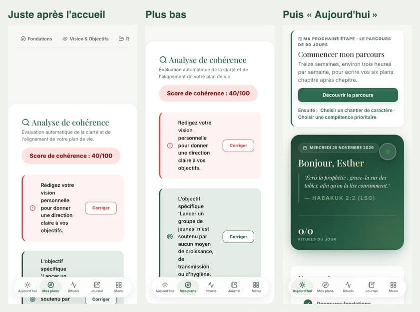

- **Ce qui ne va pas** : l'accueil des nouveaux inscrits (4 étapes) est beau. Mais juste après, on atterrit sur une
  « Analyse de cohérence » : **score 40/100 sur fond rose**, cartes à bord rouge, texte coincé en colonne d'un mot par
  ligne, onglets coupés, grand vide au-dessus. Puis « Aujourd'hui » affiche deux fois la même étape (« Ma prochaine
  étape » et « Vos premiers pas ») avant même le bonjour ; la carte « date de naissance » s'intercale.
- **Pourquoi** : c'est le moment où l'on décide de revenir. On vient d'écrire sa raison d'être : il faut un « bravo,
  vos fondations sont posées », pas une note rouge.
- **Correction** : après l'accueil, un écran de félicitation sobre (raison d'être et valeurs mises en valeur, point
  d'or, une action « Voir mon Plan de Vie »). Score présenté comme un chemin (« 3 pistes pour enrichir »), en or et non
  en rouge. Sur Aujourd'hui : le bonjour d'abord, une seule « prochaine étape ». 1 journée.

### 9. Les portes d'entrée : contraste faible, champ brut, mentions « [À COMPLÉTER] »

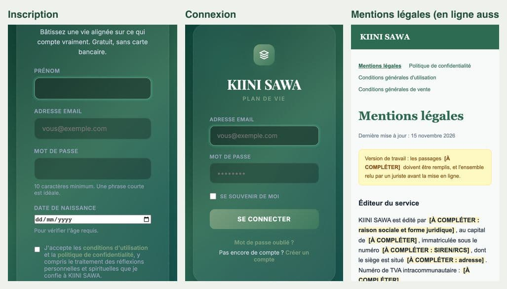

- **Ce qui ne va pas** : bouton blanc sur vert sauge (contraste ≈ 2,9 pour 1), liens « Mot de passe oublié ? » et
  « Créer un compte » vert pâle sur vert foncé (≈ 2,6), libellés en petites majuscules, champ de date blanc au milieu du
  formulaire sombre (aussi en ligne). Les mentions légales affichent en ligne un encadré jaune « Version de travail » et
  7 « [À COMPLÉTER] » surlignés.
- **Pourquoi** : la connexion est l'écran le plus vu ; un contraste faible gêne les personnes âgées et en plein soleil
  (usage fréquent en Afrique). Les « [À COMPLÉTER] » font douter du sérieux.
- **Correction** : voir n° 2 pour le fond ; boutons en vert `--primary`, liens soulignés lisibles. Pour les mentions :
  les champs dépendent de la société à créer (à ne pas inventer), mais l'encadré jaune et le surlignage peuvent
  devenir une phrase neutre (« Informations en cours d'immatriculation »). ½ journée.

### 10. Finitions sur téléphone

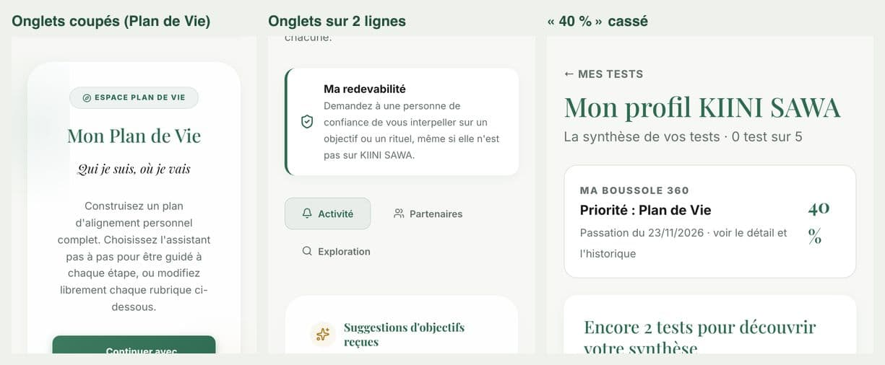

- **Ce qui ne va pas** : onglets du Plan de Vie coupés à droite (« R… ») sans signe qu'on peut faire défiler ; onglets
  de Partenaires sur deux lignes ; « 40 % » de la Boussole coupé en « 40 / % » ; tableau d'Intendance plus large que
  l'écran ; types de note du Journal coupés (« RÉSOLUTION ») ; filtres de Rituels en pyramide centrée ; échelle du
  Bilan du jour avec « joyeuse » renvoyé à la ligne.
- **Pourquoi** : sur téléphone (la majorité des membres), ces petits accrocs font « pas fini ».
- **Correction** : un composant d'onglets défilants avec fondu à droite, chiffres insécables, tableau en fiches comme
  dans l'administration. ½ journée.

---

## 3. Constat écran par écran

**Visiteur**
- **Vitrine** : la plus belle page. Héros vert, livre, captures réelles, schéma des 6 plans. Très longue sur téléphone
  (≈ 15 écrans) : resserrer. Bouton « Commencer gratuitement » un peu pâle.
- **Boussole 360** : claire, une question à la fois, barre de progression. Réponses : chiffre à gauche, libellé collé à
  droite (aligner le libellé à gauche). Connecté, on perd le menu de l'application.
- **Pages légales** : autre police, encadré jaune de travail visible en ligne.
- **Inscription / connexion / mot de passe oublié** : voir n° 2 et 9. Le petit débordement horizontal du halo décoratif
  (le fond « bouge » sur le côté).
- **Page introuvable** : en ligne, soignée et rassurante.

**Premier pas**
- **Vérification de l'e-mail** : simple et claire ; bouton « VALIDER » en majuscules ; le fond s'arrête avant le bas de
  l'écran.
- **Accueil des nouveaux inscrits** : très réussi (4 étapes, barre, valeurs proposées). La barre de navigation du bas
  reste affichée et invite à fuir le parcours : la masquer. Boutons « Continuer » désactivés trop pâles.
- **Première visite** : voir n° 8.

**Usage quotidien**
- **Aujourd'hui** : bel en-tête vert avec verset ; ordre à revoir (bonjour d'abord), doublon d'étapes, bouton
  « Enregistrer » sans style, sur ordinateur tout tient dans 470 px au centre d'un grand vide.
- **Rituels** : clair ; message « Ne manquez jamais deux fois » bien vu ; filtres en pyramide sur téléphone.
- **Journal** : pas de titre en haut, pilule noire, type de note coupé, bouton d'envoi cassé.
- **Agenda** : propre ; filtres colorés hors palette ; sur téléphone le mois est serré mais lisible.
- **Bilan** : trop de boutons ; onglets Compétences / Caractère / Relations sans rapport visible avec « Bilan ».
- **Bilan du jour, Revue de la semaine** : bons formulaires, rythme apaisé. **Revue du mois** : quatre gros chiffres
  vides (« 0, —, —, 0/0 ») ; préférer une phrase d'encouragement. **Ma saison** : très joli choix des 4 saisons.

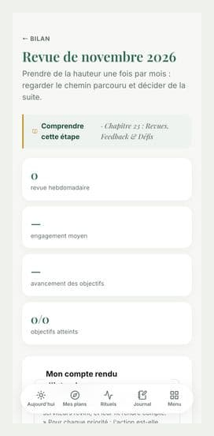

**Plans et connaissance de soi**
- **Mes plans** : schéma des plans élégant ; titre précédé d'une icône carrée isolée.
- **Plan de Vie** : en-tête différent de tous les autres (carte centrée) ; 3 boutons ; onglets coupés.
- **Croissance, Développement, Hygiène, Transmission** : voir n° 1.
- **Intendance** : belle page (verset, cycle en 4 temps) ; tableau qui déborde sur téléphone.
- **Mes tests** : carte bleu nuit, icônes multicolores, petite barre « 0/9 tests » trop discrète.
- **Page de test (DISC)** : titre rouge ; boutons « + / – » clairs.
- **Mon profil KIINI SAWA** : sobre ; « 40 % » coupé.
- **Feedback nourricier (membre)** : texte riche, schéma des trois témoins réussi ; long avant l'action (le lien
  « Aller directement à la création » aide).
- **Feedback (personne invitée)** : excellente, une seule action dorée, explications claires.

**Ensemble**
- **Partenaires** : états vides bien écrits ; onglets sur deux lignes.
- **Ma redevabilité** : modèle à suivre (une action, chiffres clairs, historique).
- **Sanctuaire du Couple** : identité terre cuite assumée et chaleureuse ; densité forte sur ordinateur.
- **Défis, Organisation, Inviter mes proches** : simples et propres, un peu vides.

**Méthode, Académie**
- **Le livre** : liste de chapitres lisible ; tableau des plans trop serré sur téléphone.
- **Académie** : catalogue en vignettes et page de parcours du niveau visé ; lecteur vidéo bien intégré. La seule
  vignette visible est l'exemple « [Exemple] » : à remplacer avant la mise en avant.
- **Parcours de 90 jours** : bonne progression semaine par semaine ; une seule action.

**Compte**
- **Abonnement** : clair, choix EUR / FCFA bien placé, badges lisibles.
- **Profil** : formulaire propre mais long et sans regroupement visuel fort.
- **Notifications** : propre, cohérent.
- **Donner mon avis** : correct.

**E-mails** : un seul gabarit pour tous (bandeau vert « KIINI SAWA », bouton vert, pied gris) : cohérents et lisibles.
À aligner : gris bleutés de l'ancienne palette, filet du verset orange au lieu de l'or, « email » / « e-mail », pas de
logo.

**Administration** : la plus homogène de tout le site (menu latéral, fil d'Ariane, cartes chiffrées, tableaux en
fiches sur téléphone). Réglages : longue page de champs en majuscules, à regrouper.

---

## 4. Site et appli mobile : ce qui diverge

Jugé d'après le code (`mobile-v1/`), non vu à l'écran.

- **Bien** : mêmes couleurs que le site (copie exacte de la palette), mêmes polices (Playfair et Inter), même barre du bas
  (Aujourd'hui, Mes plans, Rituels, Journal, Menu), menu alimenté par le site, taille tactile minimale de 44 px prévue.
- **En-têtes** : un composant commun existe (`ScreenHeader`) mais **17 écrans sur 32** font le leur (Plan, Boussole,
  Couple, Académie, Tests…), avec des surtitres tantôt or, tantôt verts, en 10 ou 11 px.
- **Couleurs en dur** : 39, dont indigo et rose sur l'écran du couple (étrangers à la palette, différents du site qui
  utilise la terre cuite).
- **Petits textes** : 49 réglages de taille sous 12 px.
- **Trous de parcours** : inscription, accueil des nouveaux inscrits, profil, abonnement, bilan du jour, saison
  s'ouvrent dans le navigateur, donc sur l'écran vert sombre en verre du site : rupture visuelle forte au moment de
  s'inscrire ou de payer.
- **À faire avant Google Play** : voir les écrans sur un vrai téléphone, puis appliquer les lots 2 à 4 aussi au mobile.

---

## 5. Plan de corrections par lots (du plus rentable au moins rentable)

| Lot | Contenu | Problèmes | Effort | Effet |
|---|---|---|---|---|
| **1. Urgences visibles** | Code affiché sur 4 plans ; bouton « Enregistrer » ; champs de date ; encadré « Comprendre cette étape » sur téléphone ; encadré jaune des mentions | 1, 5, 6 (partie), 9 (partie) | ½ journée | Fort : supprime ce qui fait « cassé » |
| **2. Une seule marque** | Un logo, une police de titre partout, connexion / inscription / vérification / accueil sur fond clair, contrastes AA | 2, 9 | 1 journée | Fort : l'entrée ressemble à la vitrine |
| **3. Un seul gabarit de page** | En-tête commun partout, 3 largeurs centrées, une action principale (Bilan, Plan de Vie, Journal), couleurs hors palette remplacées | 3, 4, 6, 7 | 1,5 à 2 jours | Fort : fin de l'effet « plusieurs mains » |
| **4. Premiers jours** | Écran de félicitation après l'accueil, score en chemin doré, Aujourd'hui réordonné et sans doublon, barre du bas masquée pendant l'accueil | 8 | 1 journée | Fort sur le retour des nouveaux inscrits |
| **5. Finitions téléphone** | Onglets défilants, tableaux en fiches, chiffres insécables, filtres alignés, vitrine resserrée | 10 | ½ à 1 journée | Moyen |
| **6. Récompenses et rythme** | Petites célébrations sobres (point d'or qui se remplit, « 7 jours de suite »), états vides encourageants (Revue du mois), fin de parcours de l'Académie et des 90 jours marquée | axe « continuité » | 1 à 2 jours | Moyen à fort, durable |
| **7. Appli mobile** | En-tête commun sur les 17 écrans, couleurs du couple, tailles de texte, puis captures sur un vrai téléphone | §4 | 1 à 1,5 jour | Moyen (avant Google Play : fort) |
| **8. E-mails et administration** | Palette des e-mails, « e-mail » partout, Réglages regroupés | — | ½ journée | Faible |

Ordre conseillé : **1 puis 2 et 3** (ils se nourrissent), **4** avant toute campagne d'inscriptions, **7** avant Google
Play.

---

## 6. Corrections faites le 25/11/2026 (lots 1 à 8)

Le fondateur a choisi les lots 1, 2 et 3, puis demandé d'enchaîner les autres sans attendre. Tout est fait, sauf ce qui
est indiqué à la fin. 599 tests passent ; appli mobile : `tsc` sans erreur, 46 tests.

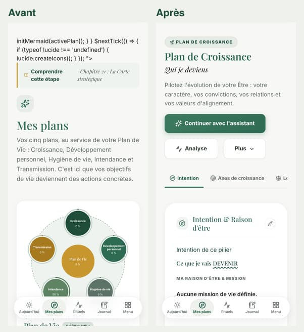
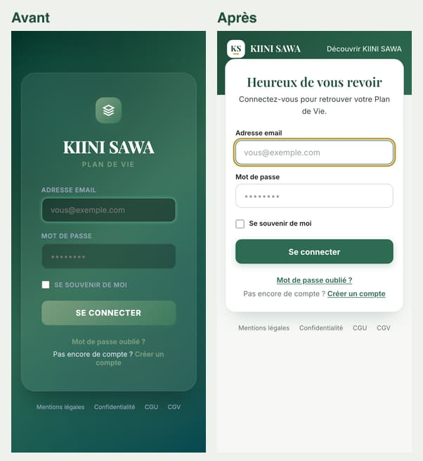
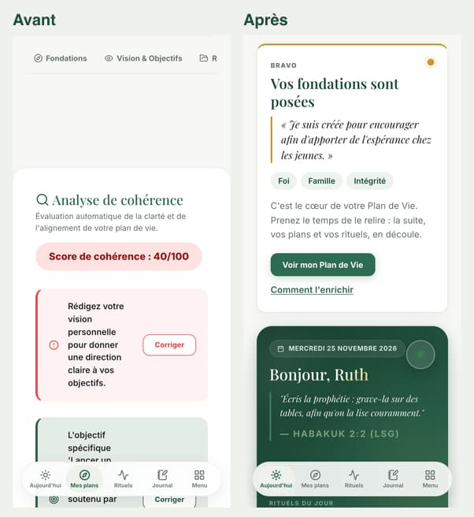
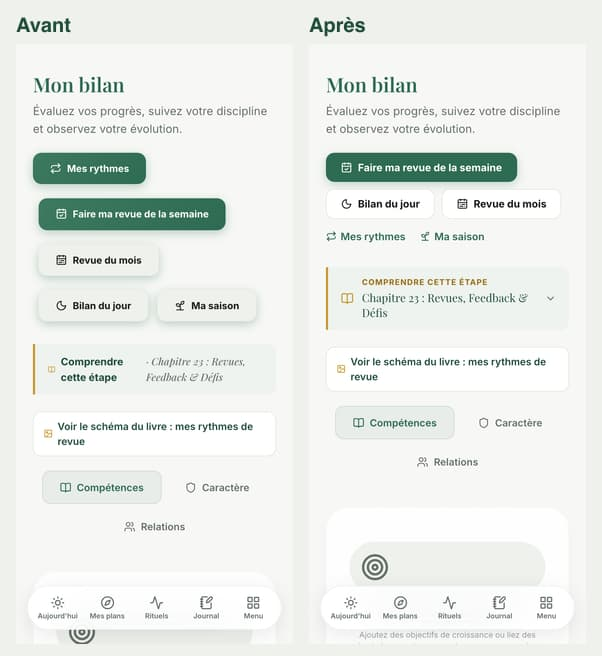

- **Lot 1** : le code ne s'affiche plus sur les 4 plans, et chacun s'ouvre sur son plan ; bouton « Enregistrer » du
  Journal et de la note rapide ; encadré « Comprendre cette étape » sur deux lignes lisibles ; mentions légales : phrase
  neutre « en cours d'immatriculation » à la place de l'encadré jaune, « à compléter » en italique discret.
- **Lot 2** : un seul logo (monogramme « KS » au filet d'or + nom) dans la barre de l'application, l'administration, la
  vitrine, la Boussole, les pages légales, la page d'erreur, les e-mails ; icônes de l'application recolorées au vert du
  livre ; connexion, inscription, vérification, accueil des nouveaux inscrits et assistant du Plan de Vie sur fond clair
  avec un bandeau vert ; pages légales et page d'erreur avec les polices de l'application ; contrastes suffisants
  (boutons verts pleins, bouton or sur les bandeaux verts, liens soulignés).
- **Lot 3** : trois largeurs de page (720, 820, 1100 px) ; en-têtes du Plan de Vie, de Mes plans, des plans, du Journal
  et des tests au modèle commun ; Bilan : une seule action principale ; couleurs hors palette remplacées (tests, Agenda,
  Journal, Rituels, Mes tests) et couleurs vives de Tailwind (bleu, violet, orange, rose…) redéfinies sur la palette.
- **Lot 4** : carte « Bravo, vos fondations sont posées » sur Aujourd'hui juste après l'accueil (raison d'être et valeurs
  reprises) ; analyse de cohérence en « pistes pour l'enrichir », en or, barre de progression, cartes lisibles sur
  téléphone ; le bonjour d'abord ; barre du bas masquée pendant l'accueil.
- **Lot 5** : onglets et filtres sur une ligne qui défilent, avec fondu ; « 40 % » insécable ; tableau d'Intendance
  contenu ; échelle du Bilan du jour ; réponses de la Boussole alignées ; tableaux du livre défilants.
- **Lot 6** : point d'or « Journée tenue » quand tous les rituels du jour sont cochés ; paliers de série (une semaine,
  trois semaines, un mois) ; Revue du mois vide encourageante ; fin de parcours de l'Académie et des 13 semaines marquée.
- **Lot 7** (appli mobile) : surtitre et titre d'écran communs, surtitre vert comme sur le site, couleurs du couple en
  terre cuite, aucun texte sous 11 px.
- **Lot 8** : e-mails sur la palette du livre avec le logo, « e-mail » partout ; libellés de formulaires en minuscules
  dans toute l'application et l'administration.

**Reste à faire** (non traité, par prudence ou faute de pouvoir le vérifier) :
- appli mobile : la voir sur un vrai téléphone ; les écrans d'inscription, de profil et d'abonnement s'ouvrent toujours
  dans le navigateur (désormais sur le fond clair) ; l'icône de l'appli dans les stores n'a pas été changée ;
- Boussole 360 connecté : toujours sans le menu de l'application ;
- vitrine : pas raccourcie (choix de contenu qui revient au fondateur) ;
- doublon « Ma prochaine étape » / « Vos premiers pas » sur Aujourd'hui : gardé (choix antérieur protégé par un test),
  mais le bonjour passe désormais en premier ;
- couleurs propres aux rapports de tests (centres de l'ennéagramme, icônes du DISC) : gardées, elles servent à
  distinguer des données ;
- mis en ligne le 25/11/2026 (vérifié : pages publiques, logo, pages claires, journal du serveur sans erreur).
