# Parcours « nouvel utilisateur » sur kiinisawa.com — 25 novembre 2026

Test fait **à l'écran, comme un humain**, sur le vrai site en production, en format téléphone (375 × 812), puis vérification des écrans clés sur ordinateur. Un compte réel a été créé (adresse donnée par le fondateur, masquée ici). Le fondateur a tapé lui-même le mot de passe et le code reçu par e-mail.

À sa demande, j'ai ensuite joué un **utilisateur très assidu** : une vie fictive mais crédible a été remplie partout (infirmier en cardiologie à Lyon, originaire de Douala, marié, deux enfants, qui veut fonder une association de prévention santé). Prénom du compte : « Testeur ».

Captures : dossier [`parcours-nouvel-utilisateur-2026-11-25/`](parcours-nouvel-utilisateur-2026-11-25/).

---

## Le résumé en 5 lignes

1. **Le fond est remarquable** : Boussole 360, accueil en 4 écrans, Équation du But, chapitres du livre, Intendance, Journal, revue de la semaine, Dons spirituels et Académie donnent une vraie impression de sérieux et de profondeur chrétienne.
2. **Deux bugs graves** : le **Plan de Transmission ne s'enregistre pas** (erreur du serveur, saisie perdue, aucun message), et le **test « Équilibre de Vie » affiche 0/10 partout** avec un conseil d'aller voir un médecin.
3. **Sur téléphone, les assistants des plans sont trop à l'étroit** : une petite fenêtre qui défile dans l'écran et qui part parfois de travers vers la gauche.
4. **Des promesses contradictoires sur le gratuit** : la Boussole promet « vos 6 plans » et « vos 5 tests » dans l'espace gratuit, alors que l'offre gratuite ne donne que le Plan de Vie et 2 tests.
5. **Beaucoup de petits mots anglais ou techniques** (DAILY, [GIVE], BE/DO/HAVE/GIVE, masterminds, « Audit non détecté »…) et un vocabulaire flottant pour le Partenaire de Redevabilité.

---

## Top 10 des corrections, par ordre d'importance

| # | Gravité | Quoi | Pourquoi c'est important |
|---|---|---|---|
| 1 | **Bloquant** | **Plan de Transmission : « Sauvegarder mon Plan » renvoie une erreur 500** (3 essais, même depuis une page rechargée). Rien ne s'affiche, la page se fige, tout est perdu. | L'utilisateur assidu perd son texte sans le savoir. C'est le dernier des 6 plans : la frustration arrive au pire moment. |
| 2 | **Grave** | **Test Équilibre de Vie : score 0,0/10 partout** malgré des réponses entre 4 et 8. Le rapport conseille de « consulter un médecin ». | C'est faux et alarmant, sur un sujet sensible (santé, famille, argent). Cela fait perdre la confiance dans tous les tests. |
| 3 | **Gênant (fort)** | **Assistants des plans sur téléphone** : fenêtre utile d'environ 200 px, 2 à 3 défilements imbriqués, contenu qui glisse vers la gauche après « Ajouter » (libellés coupés). Chaque étape s'ouvre déjà défilée au milieu. | C'est le cœur de l'application. Sur téléphone (le public visé en Afrique), remplir 6 plans dans ces conditions décourage. |
| 4 | **Gênant (fort)** | **Promesses du gratuit à aligner** : le résultat de la Boussole dit « bâtissez vos 6 plans dans votre espace gratuit » et « votre compte vous ouvre vos 5 tests ». Le tableau des prix dit : Plan de Vie seul + DISC + Dons spirituels. | Le jour où l'essai PRO s'arrête, l'utilisateur se sentira trompé. |
| 5 | Gênant | **Pas de célébration ni de score à la fin du Plan de Vie** : retour sur Aujourd'hui avec un simple bandeau. Le score de cohérence (71, puis 94 après les autres plans) est caché derrière le bouton « Analyse ». Le bouton « Voir mon Plan de Vie » de l'accueil mène en fait à Aujourd'hui. | La vitrine promet « aussitôt votre premier score de cohérence ». C'est le meilleur moment pour féliciter et motiver. |
| 6 | Gênant | **Une seule prochaine étape, pas trois** : sur Aujourd'hui, « Ma prochaine étape : faire mon bilan du jour », « Vos premiers pas : 2. Écrire votre vision » et « Ensuite : commencer mon parcours » se font concurrence. Après avoir tout rempli, on propose encore « le parcours de 90 jours pour écrire vos six plans ». | Le débutant ne sait pas quoi faire, et la vitrine promettait « une seule prochaine étape ». |
| 7 | Gênant | **Chasser l'anglais et le jargon** : DAILY/WEEKLY/MONTHLY (rituels), [GIVE]/[DO]/[BE]/[HAVE] sur les blocs ajoutés, [CHARACTER]/[RELATION]/[COMPETENCE], « (BE, DO, HAVE, GIVE) », « objectifs de type GIVE », « Habit-Rituels », « masterminds », « Binômes d'imputabilité », « Audit d'hygiène non détecté », « contre-valeurs observées ». | Le public est francophone et souvent non technicien : chaque mot étranger donne l'impression d'un produit pas fini. |
| 8 | Gênant | **Partenaire de Redevabilité** : deux espaces qui se ressemblent (« Mes partenaires », réservé aux utilisateurs inscrits, et « Ma redevabilité », ouvert à une personne extérieure) et des noms qui changent (« partenaire de confiance », « Partenaires », « partenaire de redevabilité »). | On ne sait pas lequel choisir. La règle de la maison (toujours « Partenaire de Redevabilité » en entier) n'est pas appliquée. |
| 9 | Détail utile | **Relier ce qu'on fait au Plan** : un rituel créé est « GÉNÉRAL » (pour le relier, il faut découvrir l'onglet « Enracinement ») ; le rapport Dons spirituels ne propose pas d'« ajouter à mon Plan de Vie » ; les priorités d'Intendance ne comptent ni dans le score de cohérence ni dans la revue de la semaine ; la Boussole 360 n'apparaît pas dans « Mes tests » (0/9). | Le système promet que tout est relié : ces trous cassent la promesse. |
| 10 | Détail | **Chapitres du livre** : depuis l'assistant, « Lire le chapitre » ouvre une page à part, sans bouton « revenir à mon plan / écrire maintenant » à la fin. Sur la page Plan de Vie, l'encart affiche « Comment lire ce livre » (hors sujet). Le livre est au « tu », l'appli au « vous ». | Le livre est le trésor de KIINI SAWA : il doit ramener à l'action, pas faire perdre le fil. |

À côté de ces dix points, il y a une série de détails visuels (listés plus bas) : bandeaux qui restent affichés, blocs qui apparaissent en retard au défilement, champs tronqués, bouton final caché sous la barre du bas, etc.

---

## Carnet de bord, étape par étape

### 1. Vitrine (page d'accueil, téléphone)

**Ce qui va bien**
- En 10 secondes, on comprend : « Bâtissez la vie pour laquelle Dieu vous a créé », six plans, des rituels, des partenaires.
- Le bouton doré « Commencer gratuitement » se voit bien. « Gratuit pour toujours · 14 jours de PRO offerts · sans carte bancaire » rassure.
- Le verset, les captures réelles d'un téléphone, l'offre en euros et en francs CFA (la bascule fonctionne, l'offre Duo suit aussi).

**Ce qui ne va pas**
- Les prix s'affichent d'abord en **francs CFA**, même pour un visiteur européen. L'offre Duo, placée avant le sélecteur, n'est d'abord montrée qu'en FCFA.
- La page est très longue (environ 15 écrans). Le schéma « Le système » est minuscule sur téléphone.
- Détail : le titre de l'onglet (« donnez du poids à ce qui compte vraiment ») ne reprend pas l'accroche.

### 2. Boussole 360 sans compte
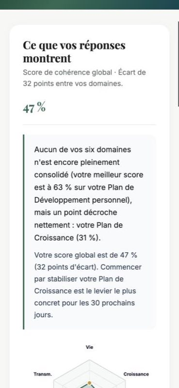

**Ce qui va bien** : 24 affirmations, on passe automatiquement à la suivante, et le résultat est personnalisé (47 %, priorité Plan de Croissance, radar, 3 actions pour la semaine). Le résultat est bien gardé et retrouvé après l'inscription.

**Ce qui ne va pas**
- **Promesses fausses** (voir le top 10, point 4) :

  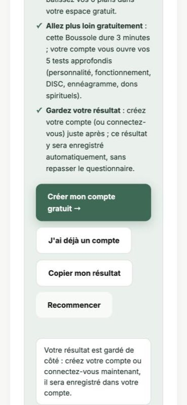
- Sur téléphone, le bouton qui était sous le doigt reste surligné à la question suivante : on croit que la réponse est déjà cochée.
- À la question 24, la barre affiche « 100 % » avant qu'on réponde, et le bouton « Voir mon résultat » est en dessous de l'écran, sans indice pour défiler.
- Le résultat s'ouvre au milieu de la page. Le point fort (63 %) est décrit de façon négative.

### 3. Inscription
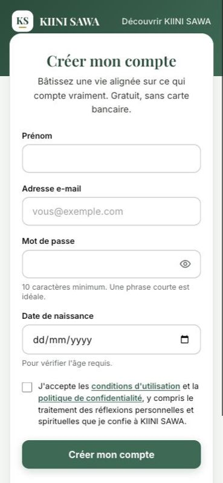

**Ce qui va bien** : seulement 4 champs, l'œil pour voir le mot de passe, une consigne claire (« une phrase courte est idéale »). Ensuite, deux bandeaux rassurants : « adresse vérifiée » et « résultat de la Boussole enregistré ».

**Ce qui ne va pas** : aucun rappel sur la page que la Boussole sera gardée. « email » dans le bandeau, « e-mail » dans le formulaire. La date de naissance prend le format du navigateur.

### 4. Accueil des nouveaux inscrits (4 écrans)
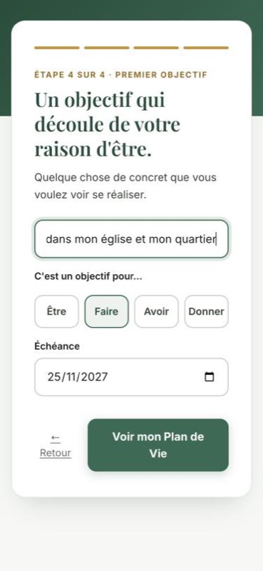

**Ce qui va bien** : c'est court. La raison d'être a des exemples concrets. Les valeurs sont des pastilles cliquables. Le premier objectif a une échéance déjà proposée (dans un an) et le choix Être / Faire / Avoir / Donner.

**Ce qui ne va pas** : le prénom est redemandé alors qu'il vient d'être saisi. Les bandeaux verts restent affichés à chaque étape. La pastille de valeur choisie ne reste pas surlignée. L'exemple de l'étape 4 est coupé (« Lancer un atelier d'orientati »). Le bouton final « Voir mon Plan de Vie » ouvre Aujourd'hui.

### 5. Première visite d'« Aujourd'hui »
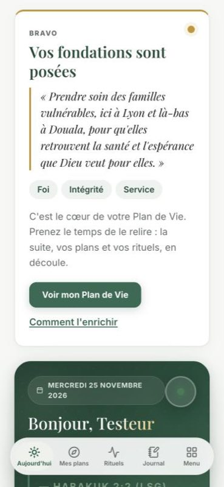 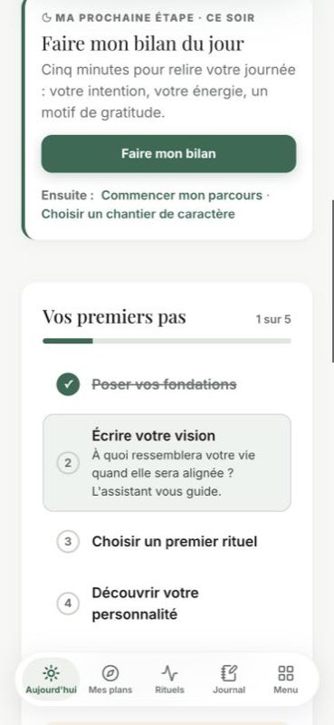

**Ce qui va bien** : la carte « Bravo, vos fondations sont posées » avec la raison d'être et les valeurs est très gratifiante. L'essai PRO jusqu'au 9 décembre est annoncé clairement. La liste « Vos premiers pas 1 sur 5 » est claire.

**Ce qui ne va pas** : trois « prochaines étapes » différentes (top 10, point 6). « 0/0 rituels du jour » sonne froid. La raison d'être est affichée deux fois. En défilant, les blocs apparaissent avec retard, ce qui laisse une zone blanche pendant environ une seconde.

### 6. Plan de Vie (assistant en 8 étapes)
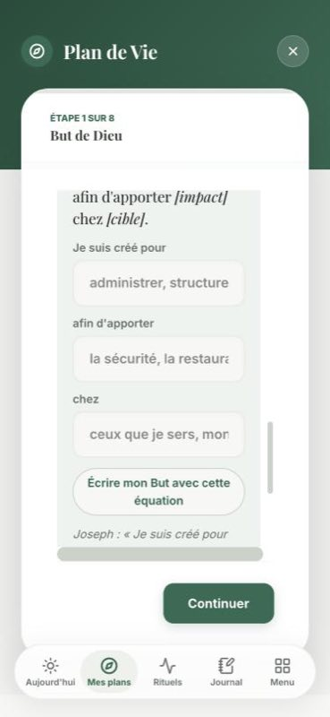 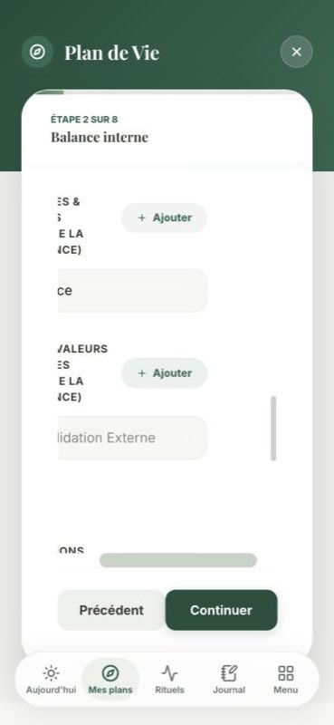

**Ce qui va bien**
- L'**Équation du But** avec les exemples de Joseph, Néhémie et Barnabas : on remplit 3 cases et la phrase s'écrit toute seule. C'est excellent.
- « Enregistré ✓ » à chaque étape. Les objectifs de l'accueil sont bien repris. Une échéance par objectif.
- Après la sauvegarde, Aujourd'hui se met à jour : « Premiers pas 2 sur 5 », nouvelle raison d'être, 5 échéances classées par date.

**Ce qui ne va pas**
- Sur téléphone : fenêtre minuscule, décalage vers la gauche (capture ci-dessus), étapes qui s'ouvrent déjà défilées.
- Les champs d'une seule ligne coupent les phrases longues (convictions, talents, objectifs) : on ne peut pas relire ce qu'on a écrit.
- Jargon (« contre-valeurs observées », « convictions dogmatiques / médianes / circonstancielles »), mélange du « tu » et du « vous ».
- L'exemple de vision n'a rien de chrétien (« consultant indépendant, travaillant depuis n'importe où dans le monde »). Le titre de l'étape 7 est en anglais.
- Fin : pas de fête, pas de score (top 10, point 5).

**Score de cohérence** : 71/100 juste après le Plan de Vie, avec 6 pistes et un bouton « Compléter » (très utile). Il passe à **94/100** une fois les autres plans remplis. Mais il faut aller le chercher, et 5 pistes sur 6 répètent la même phrase technique.

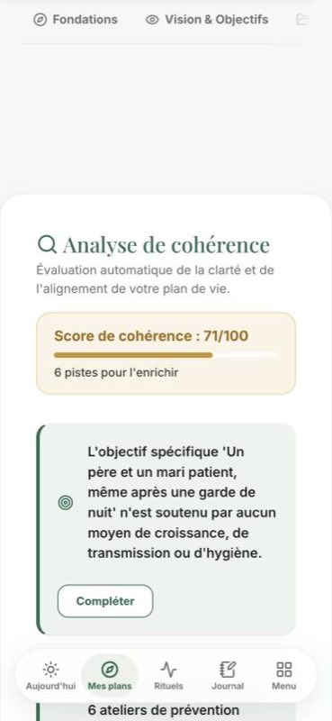

### 7. Les encarts « Comprendre cette étape » et le livre
*(Remarque du fondateur pendant le test : je ne les avais pas ouverts. C'est corrigé.)*

**Ce qui va bien** : à chaque étape, un encart repliable résume le chapitre, avec « Lire le chapitre (13 min) » et l'exercice du Sanctuaire. Le chapitre 4 (le But de Dieu) est prenant : témoignage personnel, l'image du couteau, Joseph, les six indices, l'Équation, « Et si je ne trouve pas ? », l'exercice, puis « Ce que j'écris dans mon Plan de Vie ». C'est le cœur de la valeur de KIINI SAWA.

**Ce qui ne va pas** : le chapitre quitte l'assistant et ne propose pas d'y revenir. Dans la petite fenêtre du téléphone, l'encart déplié cache les champs. Sur la page Plan de Vie, l'encart est hors sujet.

### 8. Plan de Croissance (3 étapes)
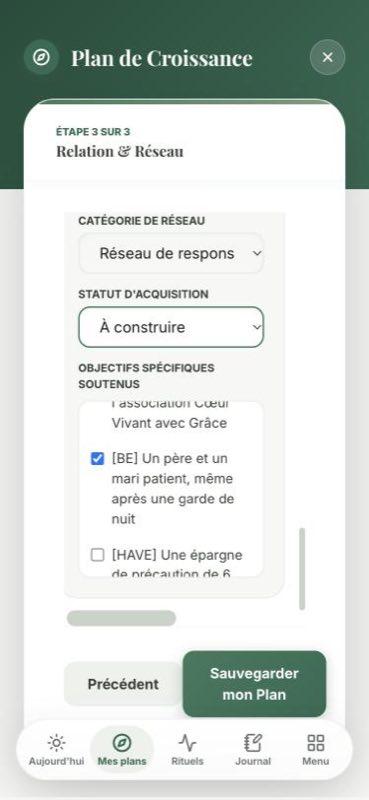

**Ce qui va bien** : il reprend la raison d'être, la vision, les objectifs et la Balance interne, sans rien ressaisir. Chaque trait de caractère et chaque personne de l'entourage se relie aux objectifs par des cases à cocher. Les 5 réseaux ont un exemple biblique.

**Ce qui ne va pas** : les blocs ajoutés affichent [GIVE]/[DO]/[BE]/[HAVE] et l'exemple vide « Ex: ... ». Il y a 3 niveaux de défilement et le décalage vers la gauche revient. Le ton fait business (« masterminds », « Binômes d'imputabilité », « mentor expert en levée de fonds », « catalyser votre réussite »). À vérifier : le premier champ « contre-valeur » saisi semblait vide ensuite.

### 9. Plan de Développement personnel et Plan d'Hygiène de vie (1 étape chacun)
**Ce qui va bien** : compétences et connaissances reliées aux objectifs. Hygiène : corps, âme et esprit avec des repères concrets (7 à 8 heures de sommeil, 150 minutes d'activité par semaine).

**Ce qui ne va pas** : la page promet « formations et livres d'étude », mais l'assistant ne les demande pas. Toucher l'intitulé d'un champ ne met pas le curseur dedans (mon texte est parti dans le vide). Exemples business (« pitcher une idée », « finance d'entreprise »). « Audit d'hygiène non détecté ». Des phrases qui commencent par une minuscule.

### 10. Plan d'Intendance
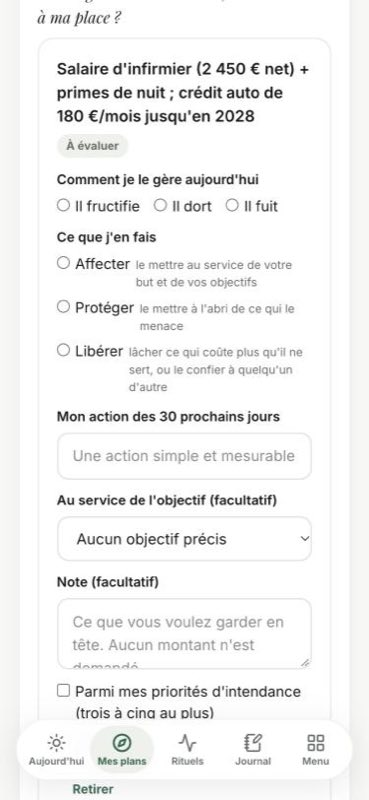 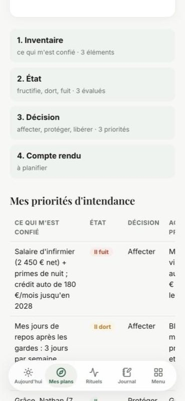

**Ce qui va bien** : c'est la page la plus aboutie. Verset, schéma en 4 temps (inventaire, état, décision, compte rendu), 7 domaines avec chacun sa question, dons et objectifs repris du Plan de Vie. On ajoute un élément en appuyant sur Entrée, puis une fiche demande s'il fructifie, dort ou fuit, et s'il faut l'affecter, le protéger ou le libérer, avec l'action des 30 prochains jours et la priorité. Les compteurs « 3 éléments · 3 évalués · 3 priorités » sont parlants.

**Ce qui ne va pas** : la présentation est complètement différente des autres plans (on se demande si c'est la même application). Chaque ajout recharge la page. Le tableau des priorités est coupé à droite sur téléphone. Ces priorités ne comptent ni dans le score ni dans la revue de la semaine.

### 11. Plan de Transmission — **bloquant**
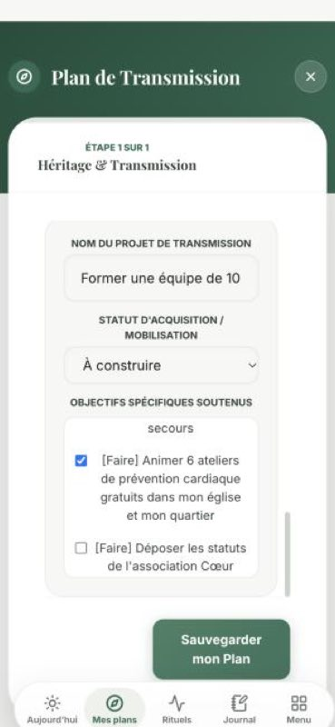 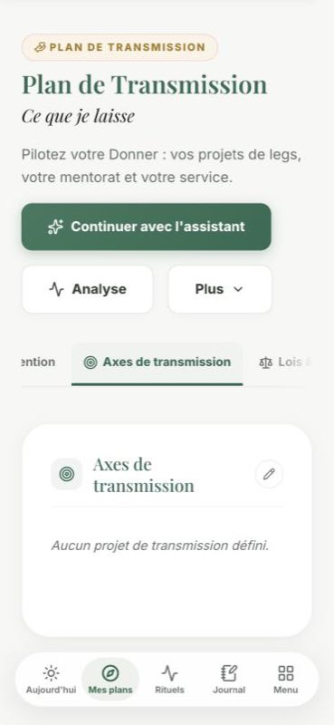

**Ce qui va bien** : le contenu est très juste (valeurs, œuvres, personnes, « Ma phrase d'éternité », « Un déplacement de trésor »).

**Ce qui ne va pas** : « Sauvegarder mon Plan » provoque une **erreur 500 du serveur** sur l'adresse `POST /plan-de-vie/assistant?step=11&single=0&plan=TRANSMISSION`. Trois essais, dont un depuis une page rechargée avec un seul champ rempli. Aucun message, la page se décale, et après rechargement on lit « Aucun projet de transmission défini ». La console du navigateur montre aussi une erreur « allLifeGoals has already been declared » quand on passe d'un assistant à l'autre. Un message caché « Plan de Croissance envoyé avec succès… » traîne sur la page Transmission.

### 12. Rituels
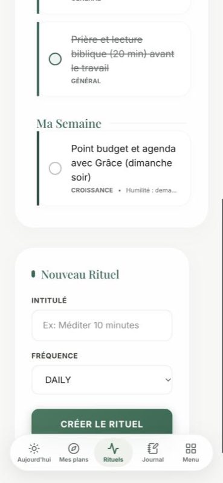

**Ce qui va bien** : création très simple. Quand on coche, le rituel est barré et une bulle dit « Rituel accompli ! ». L'onglet « Enracinement » est excellent : formule d'ancrage, action minimale de secours, déclencheur, récompense et lien à un trait (le rituel devient alors « CROISSANCE · Humilité »).

**Ce qui ne va pas** : fréquences en anglais (DAILY, WEEKLY, MONTHLY). Rien n'indique qu'il faut aller dans Enracinement pour relier un rituel à un plan. Étiquettes [CHARACTER] et autres. Les domaines d'Hygiène ne sont pas proposés. Toucher un autre rituel dans Enracinement ne change pas la fiche affichée.

### 13. Journal

**Ce qui va bien** : c'est très agréable. 6 types de notes avec chacun son invitation, humeur, énergie, bulle « Note enregistrée », fil par jour, belle typographie.

**Ce qui ne va pas** : pas de type « Prière », alors que le sous-titre parle de prières. À l'ouverture, deux types semblent choisis à la fois. L'humeur n'apparaît pas sur la note enregistrée.

### 14. Agenda
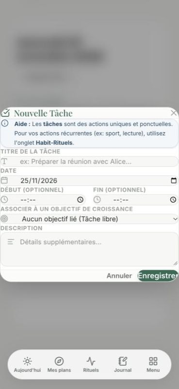

**Ce qui va bien** : vues jour, semaine, mois et frise, filtres colorés, rituels du jour repris automatiquement. Une tâche peut être reliée à un trait ou à une compétence. L'aide explique bien la différence entre une tâche et un rituel.

**Ce qui ne va pas** : la fenêtre « Nouvelle tâche » touche les bords du téléphone et le bouton « Enregistrer » est coupé. Une tâche prévue pour un autre jour disparaît sans confirmation. La vue Jour est coupée à gauche. « Habit-Rituels ».

### 15. Bilan du jour et revue de la semaine
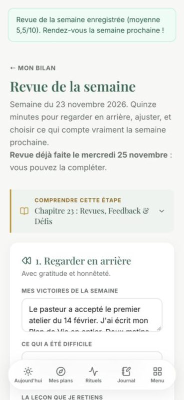

**Ce qui va bien** : le bilan du jour prend deux minutes et se termine par « Bonne soirée » et un tableau des 14 derniers jours. La **revue de la semaine rassemble tout** : victoires, difficultés, leçon, une note de 1 à 10 pour chaque trait, compétence et domaine des plans, les rituels de la semaine, le nombre de notes du Journal et les 3 priorités. Elle se termine par « moyenne 5,5/10, rendez-vous la semaine prochaine ».

**Ce qui ne va pas** : « l'intention posée ce matin », alors qu'il n'y en a pas eu le premier jour. La revue enchaîne 11 lignes de notes. L'Intendance et la Transmission en sont absentes. La page Bilan affiche « Discipline 0 % » et « Complétez votre premier bilan » juste après un bilan.

### 16. Tests
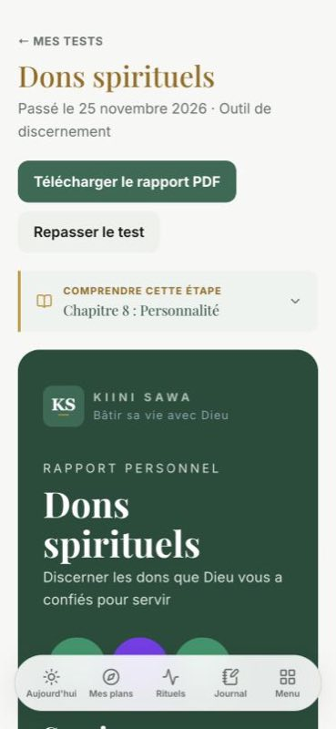 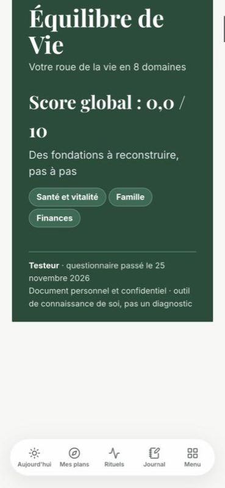

**Ce qui va bien** : la page « Mes tests » est honnête (fiabilité, sources). Le **rapport des Dons spirituels est magnifique** : Service, Enseignement, Miséricorde, signes, pièges, exemples bibliques, premier pas, et le rappel que c'est un outil de discernement, pas un verdict. La page « Mon profil KIINI SAWA » reprend la Boussole et donne envie de faire le test suivant.

**Ce qui ne va pas**
- **Équilibre de Vie : 0/10 partout** (top 10, point 2). Ce test a aussi un style visuel à part (bleu, autre police) et une question formulée sans Dieu (« connexion à quelque chose de plus grand »).
- Dons spirituels sur téléphone : 5 petits boutons serrés par ligne, et le bouton final est caché sous la barre du bas. Les boutons ne sont pas annoncés aux lecteurs d'écran.
- Compteurs incohérents (« 0/9 » d'un côté, « 1 test sur 5 » de l'autre). La Boussole n'est pas listée dans Mes tests.

### 17. Académie
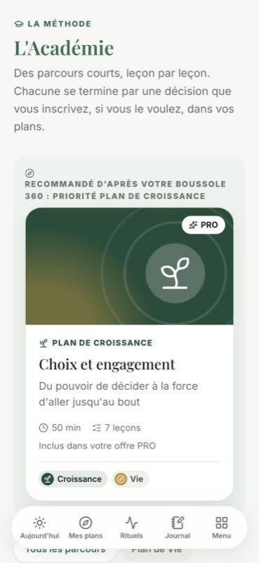 

**Ce qui va bien** : un parcours « recommandé d'après votre Boussole 360 ». La page du parcours est claire (durée, leçons, plans concernés, rythme des e-mails au choix). Les leçons sont illustrées et bibliques, avec des questions de discernement. L'exercice s'enregistre **dans le Journal ou dans le Plan de Croissance** (« Votre réponse est enregistrée dans : Plan de Croissance »), puis la leçon suivante s'ouvre.

**Ce qui ne va pas** : seulement 2 parcours, tous les deux PRO. Des phrases de machine (« Votre réponse peut aller dans : Journal : Écrire une note… »). Pas de « Bravo » après une bonne réponse.

### 18. Feedback nourricier et Partenaires de Redevabilité *(consultés, rien envoyé)*

**Ce qui va bien** : le Feedback nourricier explique très bien les 3 témoins, qui choisir, ce que verront les proches et l'anonymat à partir de 3 réponses. La Redevabilité est bien pensée : une personne même extérieure, des alertes automatiques si on décroche (une au plus tous les 7 jours), et un **aperçu du message avant l'envoi**.

**Ce qui ne va pas** : la page du Feedback est très longue avant d'arriver au bouton. Les deux espaces de partenaires se confondent et les noms varient (top 10, point 8). « Kiini Sawa » est écrit avec une casse différente.

### 19. Offre PRO
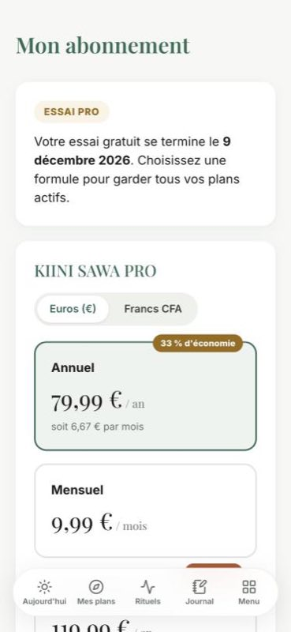

**Ce qui va bien** : c'est clair et honnête. Fin de l'essai le 9 décembre, euros ou FCFA, tableau gratuit contre PRO, « pas de renouvellement automatique, vous repassez en gratuit sans rien perdre », « le paiement n'est pas encore ouvert, écrivez-nous ».

**Ce qui ne va pas** : un bouton « Payer » reste affiché. « Écrivez-nous » n'est accompagné ni d'une adresse ni d'un bouton. Le menu dit « Essai PRO » alors que la page s'appelle « Mon abonnement ».

### 20. Vérification sur ordinateur
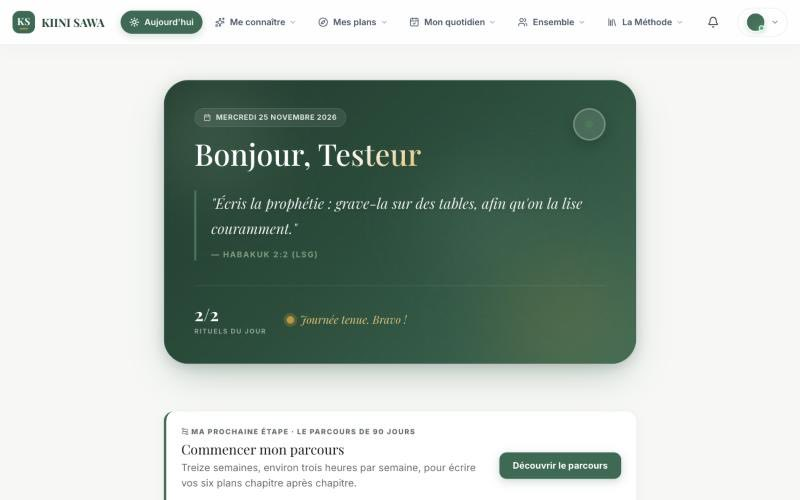 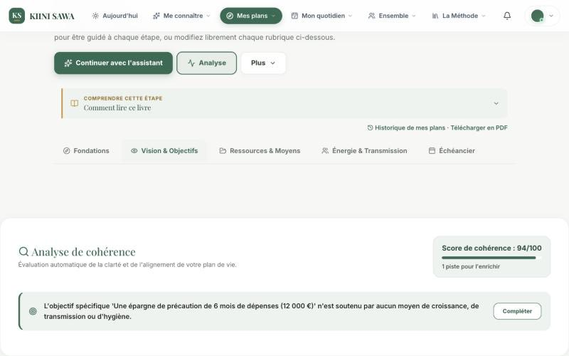

**Ce qui va bien** : la barre de menu en haut est claire et la carte « Bonjour » est belle (« 2/2 rituels · Journée tenue. Bravo ! »). L'assistant est plus confortable sur grand écran.

**Ce qui ne va pas** : l'assistant reste une carte qui défile à l'intérieur de la page. La prochaine étape proposée (« écrire vos six plans en 90 jours ») ne tient pas compte de ce qui est déjà fait.

---

## Ce qu'on ressent quand on remplit l'application à fond

- **Agréable** : rien n'est à ressaisir d'un plan à l'autre ; « Enregistré ✓ » à chaque étape ; le score qui monte (71 puis 94) ; Aujourd'hui qui se remplit (échéances, rituels, « Journée tenue. Bravo ! ») ; la revue de la semaine qui rassemble tout ; les exercices de l'Académie qui vont directement dans le plan.
- **Pénible** : sur téléphone, environ 45 minutes pour les 6 plans dans des fenêtres étroites ; des champs d'une ligne pour des phrases ; des blocs « Ajouter » dont on ne sait pas s'ils sont gardés vides ; une page qui recharge à chaque ajout (Intendance) ; une **perte totale sur le dernier plan** ; peu de fêtes aux moments forts (fin d'un plan, premier score, premier test).

## Les e-mails que ce compte devrait avoir reçus

- Le code de vérification de l'adresse (reçu : le fondateur l'a tapé).
- Possiblement un e-mail de bienvenue.
- Possiblement l'envoi d'un plan par e-mail (le message caché « Plan de Croissance envoyé avec succès à votre adresse email » suggère cette fonction).
- Aucun e-mail de l'Académie n'est attendu (le rythme « à mon rythme, sans e-mail » est resté choisi par défaut).
- À confirmer avec le fondateur : ce qu'il voit réellement dans sa boîte de réception.

## Ce qui n'a pas été testé

- Paiement (non ouvert, et interdit pendant ce test). Invitations à de vraies personnes : Feedback nourricier, Partenaire de Redevabilité, conjoint, Sanctuaire du Couple.
- Tests DISC, Profil complet, Type de fonctionnement, Ennéagramme et audit Hygiène de vie : non passés par manque de temps.
- Téléchargements PDF : non lancés.
