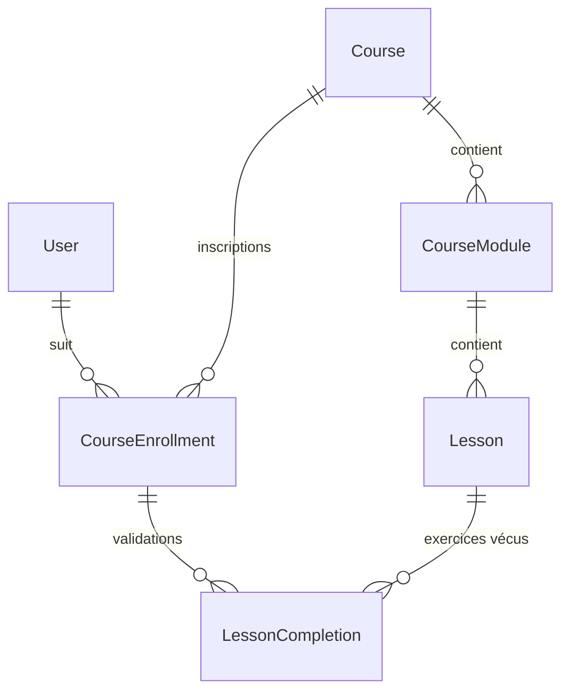

# RFC-002 : L'Académie Pratique KIINI SAWA (Cours connectés aux 6 Plans)

* **Statut** : Planifié / En Roadmap (Upcoming Release — V1.2)
* **Date de conception** : Novembre 2026
* **Périmètre** : Web Symfony (`web/src/Academie/`) + API Mobile (`/api/mobile/v1/academie/...`)
* **Type de document** : Architecture Blueprint & Spécification Technique

---

## 1. Vision Métier & Différenciation

L'Académie KIINI SAWA n'est **pas** une plateforme de cours certifiants ou théoriques :
1. **Zéro certificat papier inutile** : la preuve qu'un cours a porté du fruit, c'est ce qu'il a transformé dans la vie concrète de la personne.
2. **Chaque leçon alimente un plan réel** : à la fin de chaque leçon, un exercice pratique court permet à l'utilisateur de saisir une décision, un objectif, une ressource ou un rituel qui est **directement injecté dans son vrai Plan** (*Vie, Croissance, Développement personnel, Hygiène de vie, Intendance, Transmission*, *Rituels*, *Journal* ou *Sanctuaire Couple*).
3. **Antidote à la page blanche** : l'Académie guide pas à pas les utilisateurs qui ne savent pas par où commencer dans leurs 6 plans.

---

## 2. Modèle de Données (Module `App\Academie`)

### Entités Doctrine (`web/src/Academie/Entity/`)

1. **`Course`** (Parcours pratique)
   * `id`, `slug` (unique), `title`, `subtitle`, `description`
   * `primaryPlan` : enum/string (`VIE | CROISSANCE | DEVELOPPEMENT | HYGIENE | INTENDANCE | TRANSMISSION | COUPLE`)
   * `accessLevel` : `FREE | PRO | DUO` (piloté par `Entitlements`)
   * `estimatedMinutes` : INT (durée totale estimée)
   * `isPublished` : BOOL, `sortOrder` : INT
   * `createdAt`, `updatedAt`

2. **`CourseModule`** (Chapitre / Section du parcours)
   * `id`, `course_id` (FK), `title`, `sortOrder`

3. **`Lesson`** (Leçon pratique — 5 à 10 min)
   * `id`, `module_id` (FK), `slug`, `title`, `sortOrder`
   * `contentMarkdown` : TEXT (enseignement concis, sobre, lisible hors-ligne)
   * `mediaUrl` : VARCHAR(500) nullable (audio ou vidéo externe — ex. Cloudflare R2 / Bunny Stream ; **jamais** de gros fichiers MP4 sur Hostinger)
   * `durationMinutes` : INT
   * **Pont vers les 6 Plans (le cœur de la RFC)** :
     * `practicePrompt` : TEXT nullable (consigne de l'exercice pratique de fin de leçon)
     * `targetPlan` : VARCHAR(30) nullable (`VIE | CROISSANCE | DEVELOPPEMENT | HYGIENE | INTENDANCE | TRANSMISSION | RITUEL | JOURNAL | COUPLE`)
     * `targetAction` : VARCHAR(40) nullable (voir table de mapping `AcademyPlanBridge` ci-dessous)
     * `practiceSchema` : JSON nullable (champs attendus par le mini-formulaire : ex. `title`, `category`, `state`, `frequency`)

4. **`CourseEnrollment`** (Suivi d'un utilisateur)
   * `id`, `user_id` (FK), `course_id` (FK) — contrainte unique `(user_id, course_id)`
   * `startedAt`, `lastActivityAt`, `completedAt` (nullable)

5. **`LessonCompletion`** (Validation + trace de l'entrée injectée)
   * `id`, `enrollment_id` (FK), `lesson_id` (FK) — contrainte unique `(enrollment_id, lesson_id)`
   * `responseData` : JSON nullable (ce que l'utilisateur a saisi dans l'exercice)
   * `createdEntityType` : VARCHAR(60) nullable (ex. `StewardshipItem`, `Habit`)
   * `createdEntityId` : INT nullable (identifiant de l'entrée créée dans le plan cible, pour permettre un lien direct *« Voir dans mon Plan d'Intendance »* et éviter les doublons en cas de re-soumission)
   * `completedAt` : DATETIME

---

## 3. Le Pont vers les 6 Plans (`AcademyPlanBridge`)

Service dédié `App\Academie\Service\AcademyPlanBridge` qui reçoit `(User $user, Lesson $lesson, array $input)` et crée ou met à jour l'entité métier réelle dans le module concerné :

| `targetPlan` | `targetAction` | Entité KIINI SAWA alimentée | Exemple concret |
| :--- | :--- | :--- | :--- |
| `VIE` | `update_purpose` | `PlanDeVie\Entity\Purpose` | Poser son Équation du But |
| `VIE` | `add_value` | `PlanDeVie\Entity\Value` | Ajouter une valeur directrice |
| `VIE` | `add_life_goal` | `PlanDeVie\Entity\LifeGoal` | Créer un objectif (Être/Faire/Avoir/Donner) |
| `CROISSANCE` | `add_growth_goal` | `PlanDeCroissance\Entity\GrowthGoal` | Choisir un trait de caractère à travailler |
| `CROISSANCE` | `add_principle` | `PlanDeCroissance\Entity\Principle` | Ajouter un principe de croissance |
| `DEVELOPPEMENT` | `add_skill_goal` | `PlanDeDeveloppement\Entity\SkillGoal` | Définir une compétence levier du trimestre |
| `DEVELOPPEMENT` | `add_learning_resource` | `PlanDeDeveloppement\Entity\LearningResource` | Ajouter un livre ou une formation ciblée |
| `HYGIENE` | `add_hygiene_domain` | `PlanDHygiene\Entity\HygieneDomain` | Poser une pratique d'hygiène mesurable |
| `INTENDANCE` | `add_stewardship_item` | `PlanDIntendance\Entity\StewardshipItem` | Inventorier une ressource (*fructifie / dort / fuit*) + décision |
| `TRANSMISSION` | `add_legacy_goal` | `PlanDeTransmission\Entity\LegacyGoal` | Définir un objectif de legs |
| `TRANSMISSION` | `add_transmission_action` | `PlanDeTransmission\Entity\TransmissionAction` | Planifier un acte concret de transmission |
| `RITUEL` | `add_habit` | `Rituels\Entity\Habit` | Créer un rituel quotidien ou hebdomadaire |
| `JOURNAL` | `add_note` | `Journal\Entity\ReflectionNote` | Enregistrer un déclic ou une réflexion |
| `COUPLE` | `add_couple_item` | `Couple\Entity\CoupleItem` | Ajouter un projet, rituel ou intention de couple |

### Règles de sécurité & intégrité du Pont
1. **Consentement visible** : le bouton indique explicitement où va l'entrée (*« Valider la leçon et ajouter à mon Plan d'Intendance »*), avec une option secondaire *« Valider la leçon sans modifier mon plan »*.
2. **Idempotence** : si l'utilisateur revient modifier son exercice sur une leçon déjà complétée, `AcademyPlanBridge` vérifie `createdEntityId` (appartenant bien à `$user`) pour **mettre à jour** l'entrée existante plutôt que de créer un doublon.
3. **Droits PRO (`Entitlements`)** : la création d'entrées dans les plans PRO respecte les mêmes règles `Entitlements::can()` que l'application principale.
4. **Zéro modification silencieuse** : une entrée existante dans le Plan de Vie (`Purpose`, `Vision`) n'est jamais écrasée sans affichage préalable du texte actuel et confirmation explicite.

---

## 4. Contrat d'API Mobile (`/api/mobile/v1/academie/...`)

* **`GET /api/mobile/v1/academie/parcours`** : catalogue des parcours filtrable par plan (`?plan=INTENDANCE`), avec progression de l'utilisateur (`completedLessons / totalLessons`).
* **`GET /api/mobile/v1/academie/parcours/{slug}`** : détail d'un parcours, modules et liste des leçons (avec statut `completed`).
* **`GET /api/mobile/v1/academie/lecons/{id}`** : contenu de la leçon + schéma de l'exercice pratique (`targetPlan`, `practicePrompt`, `practiceSchema`, `existingResponse`).
* **`POST /api/mobile/v1/academie/lecons/{id}/valider`** : valide la leçon et exécute `AcademyPlanBridge` si `applyToPlan: true` → retourne `{ completed: true, createdEntity: { plan, label, id } }`.

---

## 5. Administration & Import des Cours Existants

* **Back-office dédié (`/admin/academie`)** : création et édition de parcours, modules, leçons et liaison `targetPlan / targetAction` (en respectant l'architecture contrôleurs Symfony de `docs/admin.md`).
* **Commande d'import** : `php bin/console app:academie:import` pour importer les cours déjà présents dans `formation/courses_dump.json` en brouillon (`isPublished = false`), afin de les relire et de brancher chaque leçon sur son plan cible avant publication.

---

## 6. Jalons de Réalisation

| Jalon | Intitulé | Livrables |
| :--- | :--- | :--- |
| **Jalon 1** | **Socle Backend & `AcademyPlanBridge`** | Entités, migration Doctrine, service `AcademyPlanBridge` (couvrant les 6 plans + Rituels + Journal), tests unitaires et fonctionnels. |
| **Jalon 2** | **Interface Web & Admin** | Pages `/academie`, lecteur de leçon avec formulaire d'exercice connecté au plan cible, et gestion `/admin/academie` + import `formation/`. |
| **Jalon 3** | **API Mobile & Écrans `mobile-v1`** | Contrôleur `MobileAcademyController`, écrans natifs `app/academie/` et cache SQLite hors-ligne pour la lecture des leçons. |
| **Jalon 4** | **Recommandation contextuelle** | Relier `Ma Boussole 360` et les revues à l'Académie : proposer automatiquement le parcours correspondant au plan prioritaire de l'utilisateur. |
